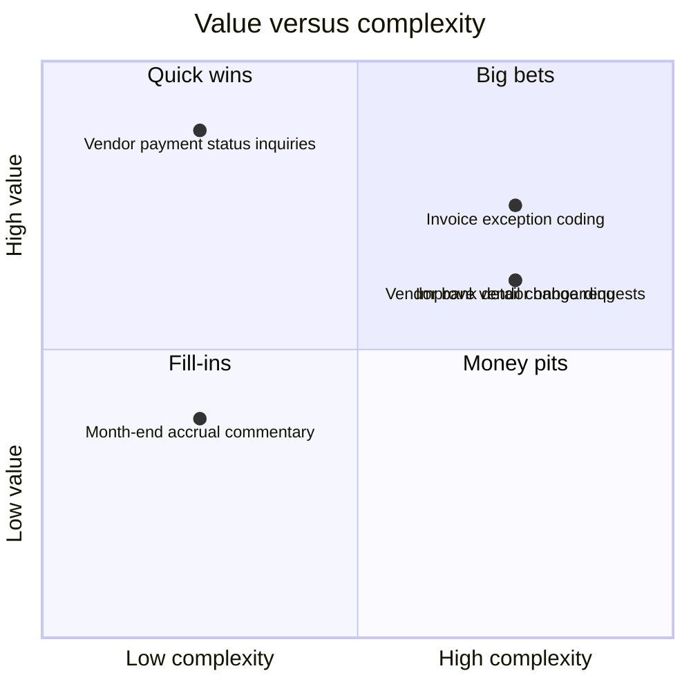

## Candidate ranking

| Rank | Idea | Gate 1 | Value | Ease | Priority | Quadrant | Risk |
|---|---|---|---|---|---|---|---|
| 1 | Vendor payment status inquiries | pass | 4.5 | 4.0 | 18.0 | quick win | 2 |
| 2 | Invoice exception coding | pass | 4.0 | 2.7 | 10.7 | big bet | 3 |
| 3 | Month-end accrual commentary | pass | 2.5 | 4.0 | 10.0 | fill-in | 2 |
| 4 | Vendor bank detail change requests | pass | 3.5 | 2.0 | 7.0 | big bet | 5 |
| 5 | Improve vendor onboarding | reframe: low discrete, testable | 3.5 | 2.3 | 8.2 | big bet | 3 |

Priority = value x ease (max 25). Value averages how valuable and how frequent. Ease averages low complexity, data readiness, and low risk.

**Suggested starting point:** Vendor payment status inquiries (quick win, priority 18.0).

