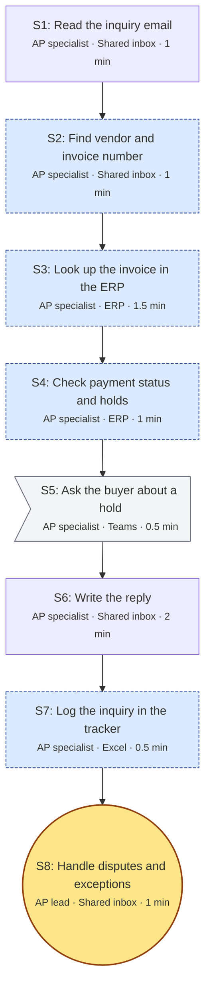
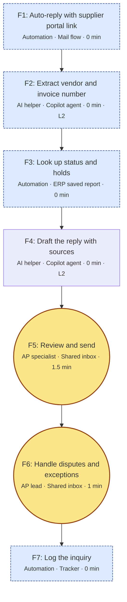

## Workflow map: Vendor payment inquiries

### Current state

Legend: rounded and yellow = circled (judgment, approval, communication, stays human); dashed blue = underlined (copy, lookup, transform, hand over first); grey = waiting.

### Current state: summary

| Measure | Value |
|---|---|
| Steps | 8 |
| Hands-on (touch) minutes per occurrence | 8.5 |
| Waiting minutes per occurrence | 48 |
| Cycle time per occurrence (touch + wait) | 56.5 min |
| Handoffs between people | 1 |
| Steps done by AI or automation | 0 |
| Hands-on hours per month | 59.5 |

**Where the hands-on time goes, by step type**

| Step type | Minutes | Share | Group |
|---|---|---|---|
| copy | 0.5 | 6% | underlined |
| lookup | 2.5 | 29% | underlined |
| transform | 1 | 12% | underlined |
| language | 3 | 35% |  |
| judgment | 1 | 12% | circled |
| wait | 0.5 | 6% |  |

Underlined (copying) time: 4 min (47%). Circled (judgment) time: 1 min (12%).

**Hands-on minutes by role**

| Role | Minutes | Share |
|---|---|---|
| AP specialist | 7.5 | 88% |
| AP lead | 1 | 12% |

**Single points of knowledge:** S8 (Handle disputes and exceptions)

**Error-prone steps:** S2 (Find vendor and invoice number), S4 (Check payment status and holds)

**Most painful steps:** S5 (Ask the buyer about a hold, pain 3), S2 (Find vendor and invoice number, pain 2), S3 (Look up the invoice in the ERP, pain 2)

### Future state

Legend: rounded and yellow = circled (judgment, approval, communication, stays human); dashed blue = underlined (copy, lookup, transform, hand over first); grey = waiting.

### Future state: summary

| Measure | Value |
|---|---|
| Steps | 7 |
| Hands-on (touch) minutes per occurrence | 2.5 |
| Waiting minutes per occurrence | 0 |
| Cycle time per occurrence (touch + wait) | 2.5 min |
| Handoffs between people | 1 |
| Steps done by AI or automation | 5 |
| Hands-on hours per month | 17.5 |

**Where the hands-on time goes, by step type**

| Step type | Minutes | Share | Group |
|---|---|---|---|
| judgment | 1 | 40% | circled |
| approval | 1.5 | 60% | circled |

Underlined (copying) time: 0 min (0%). Circled (judgment) time: 2.5 min (100%).

**Hands-on minutes by role**

| Role | Minutes | Share |
|---|---|---|
| Automation | 0 | 0% |
| AI helper | 0 | 0% |
| AP specialist | 1.5 | 60% |
| AP lead | 1 | 40% |

**Most painful steps:** F6 (Handle disputes and exceptions, pain 1)

### Before and after

| Measure | Current | Future | Change |
|---|---|---|---|
| Steps | 8 | 7 | -1 |
| Touch minutes per occurrence | 8.5 | 2.5 | -6 |
| Wait minutes per occurrence | 48 | 0 | -48 |
| Handoffs between people | 1 | 1 | +0 |
| Steps done by AI or automation | 0 | 5 | +5 |
| Hands-on hours per month | 59.5 | 17.5 | -42.0 |

These future-state minutes are estimates until Step 5 measures them. Make sure future touch minutes include the time a person spends reviewing AI output.
